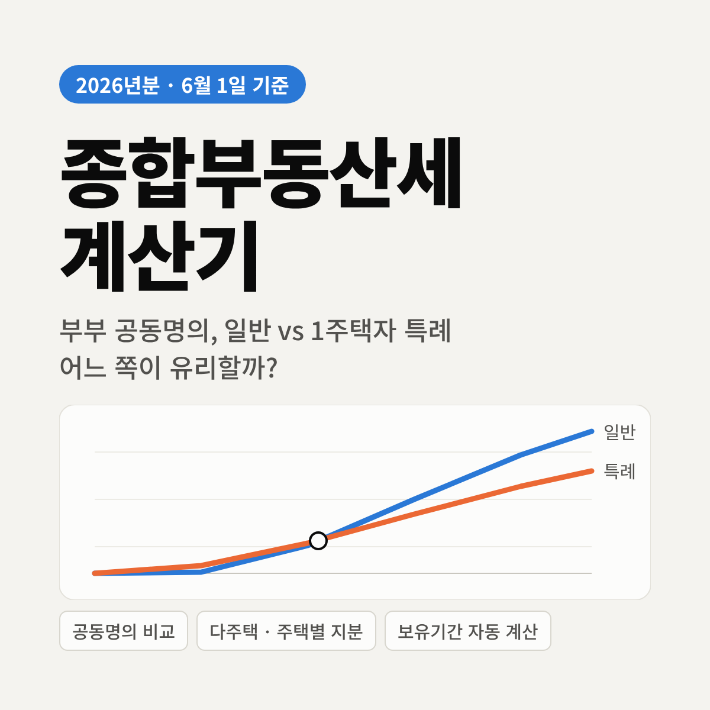

# 2026 종합부동산세 계산기

부부 공동명의 1주택이라면 **일반 방식(1인당 9억 공제)**과 **1주택자 특례(12억 공제 + 고령자·장기보유 세액공제)** 중 어느 쪽이 유리한지 비교해 줍니다.
다주택 세대는 주택마다 명의와 지분을 따로 넣어 소유자와 배우자 각자의 종부세를 계산합니다.

**바로 사용하기:** https://USERNAME.github.io/REPO/

설치할 것 없이 `index.html` 파일 하나로 브라우저에서 작동합니다. 입력한 정보는 어디로도 전송되지 않습니다.

## 주요 기능

- **1주택 / 다주택 선택:** 다주택이면 '+ 주택 추가'로 주택을 계속 넣을 수 있습니다.
- **주택별 입력:** 공시가격, 명의(소유자 단독 / 배우자 단독 / 부부 공동), 지분 비율, 취득일
- **날짜로 자동 계산:** 생년월일과 취득일을 넣으면 2026년 6월 1일 기준 만 나이, 보유기간, 공제율이 자동으로 나옵니다.
- **공동명의 1주택:** 일반 방식과 특례 세액을 비교해 유리한 쪽과 차액을 보여줍니다. 특례 납세의무자는 부부 중 유리한 사람으로 자동 선택합니다.
- **공시가격별 비교 그래프:** 같은 나이·보유기간·지분에서 공시가격 몇 억부터 특례가 유리해지는지 보여줍니다.
- **다주택:** 사람별 주택 수(공동소유는 각자 1채), 3주택 이상 중과세율, 재산세 중복분 공제, 주택별 재산세를 계산합니다.

## 계산 기준 (2026년분)

| 항목 | 기준 |
|---|---|
| 과세기준일 | 2026년 6월 1일 (납부 2026년 12월) |
| 기본공제 | 1인당 9억 / 단독명의 1세대 1주택·공동명의 특례 12억 |
| 공정시장가액비율 | 종부세 60% / 재산세: 세대 1주택 43~45%, 다주택 60% |
| 세율 (2채 이하) | 0.5% · 0.7% · 1.0% · 1.3% · 1.5% · 2.0% · 2.7% (과세표준 3·6·12·25·50·94억 구간) |
| 세율 (3채 이상) | 과세표준 12억 초과분부터 2.0% · 3.0% · 4.0% · 5.0% |
| 고령자 세액공제 | 만 60세 20% · 65세 30% · 70세 40% |
| 장기보유 세액공제 | 5년 20% · 10년 40% · 15년 50% (고령자와 합쳐 최대 80%, 세대 1주택만) |
| 농어촌특별세 | 종부세의 20% |

### 보유기간 계산

- 보유기간은 취득일부터 그해 6월 1일까지 꽉 채운 햇수로 셉니다. 2021년 6월 1일에 취득했으면 5년, 6월 2일에 취득했으면 4년 11개월입니다.
- 부부 공동명의 주택은 부부 중 먼저 산 사람의 최초 취득일부터 셉니다. 증여로 공동명의가 된 날이 기준이 아닙니다.

## 반영하지 않은 것

- 세부담 상한(전년 보유세의 150%)
- 일시적 2주택·상속주택·지방 저가주택의 1주택 특례
- 합산배제 임대주택
- 다른 세대원(자녀 등) 명의 주택, 부속토지만 가진 경우
- 지자체 조례에 따른 재산세율 조정

재산세 중복분 공제는 표준세율 0.4%를 기준으로 근사 계산합니다.
**이 계산기는 참고용입니다. 실제 고지액은 홈택스 모의계산이나 세무 전문가를 통해 확인하세요.**

## 2027년 이후

정부가 2026년 8월 발표한 세제개편안에는 다음 변경안이 담겨 있습니다. 국회를 통과하면 2027년분부터 적용되므로, 이 계산기는 2026년분에만 해당합니다.

- 1주택 공제를 거주 14억 · 비거주 9억으로 나눔
- 공정시장가액비율 상향
- 다주택 공제를 '4억 + 5억 × 거주주택 비중'으로 변경
- 보유기간 대신 거주기간 중심의 공제

## GitHub Pages로 배포하기

1. 이 저장소에 `index.html`, `og-image.png`, `README.md`를 올립니다.
2. 저장소 **Settings → Pages**에서 Source를 `Deploy from a branch`, Branch를 `main` / `(root)`로 고르고 Save를 누릅니다.
3. 1~2분 뒤 `https://USERNAME.github.io/REPO/`에서 열립니다.
4. `index.html` 위쪽 `og:url`, `og:image`, `twitter:image`와 이 README의 `USERNAME/REPO`를 본인 주소로 바꿉니다. 카카오톡·SNS 미리보기 이미지는 이 절대주소가 있어야 나옵니다.

## 라이선스

MIT
